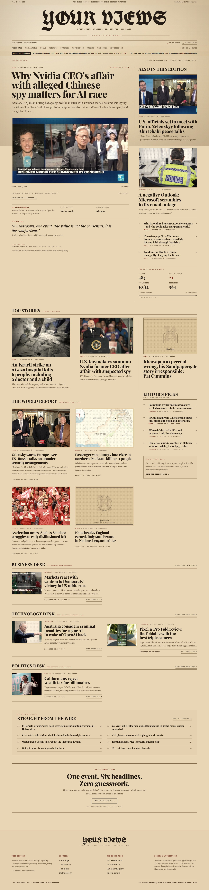
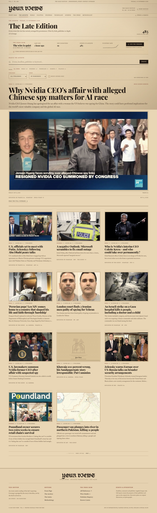
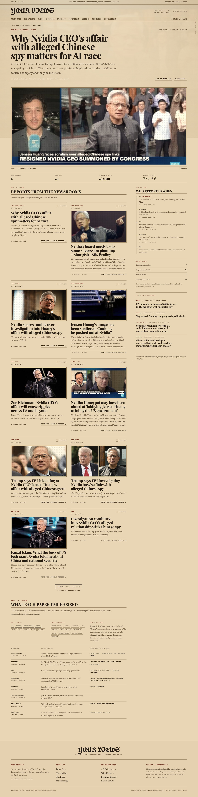
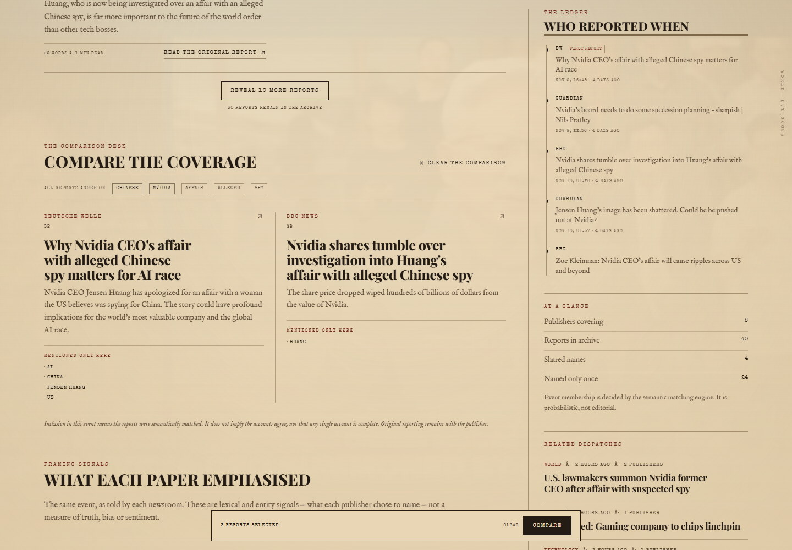
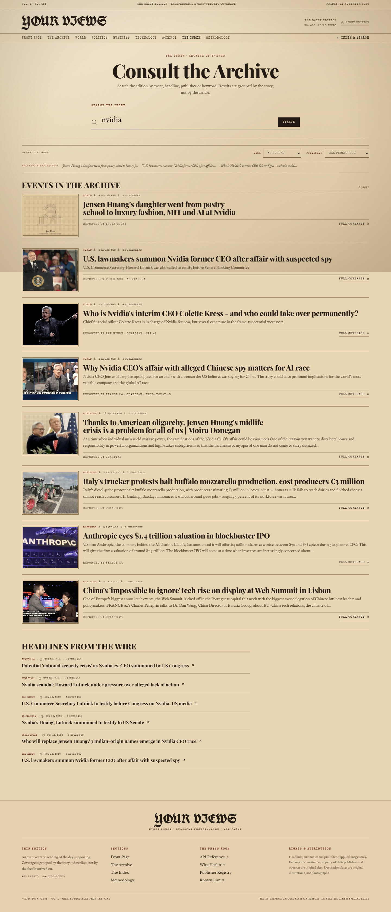
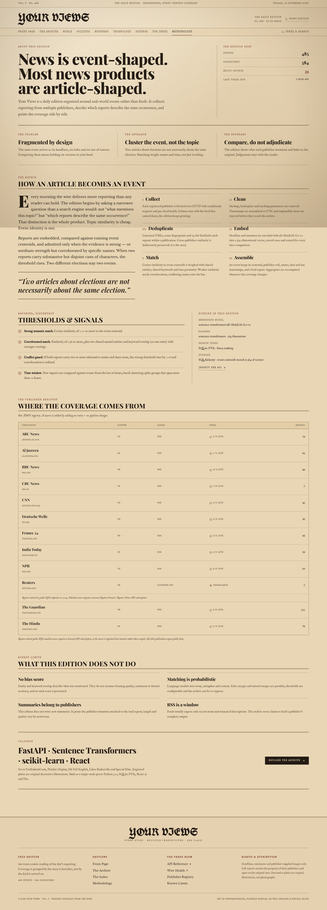
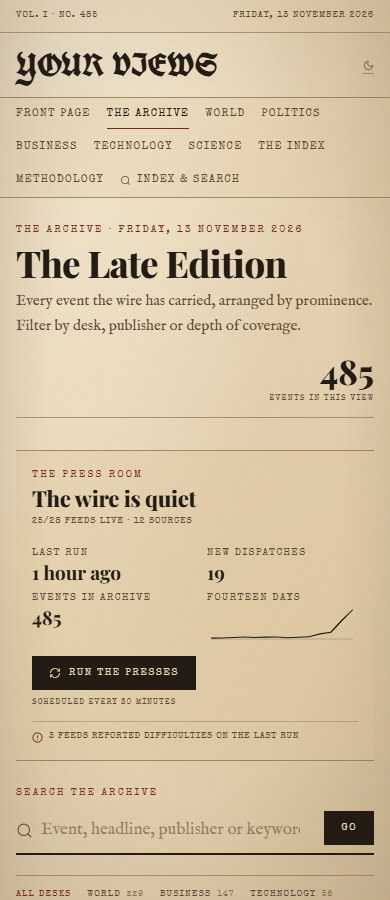

# YOUR VIEWS

**Every story. Multiple perspectives. One place.**

YOUR VIEWS is an event-centric news intelligence platform, printed as a **vintage daily
newspaper**. It ingests reporting from multiple publishers, uses sentence embeddings plus
entity/time signals to decide which articles describe the same real-world event, and presents the
coverage side by side so readers can compare how different newsrooms tell the same story.

Unlike an article feed, the primary object here is the **event**. One story per event, every
publisher attached, one editorial page to compare them — set in blackletter, Playfair Display and
IM Fell English on aged parchment.



---

## What is actually implemented

| Area | Status | Notes |
| --- | --- | --- |
| Multi-source RSS collection | Working | 12 publishers registered, 28 feeds, conditional GET, retries, per-feed health |
| Preprocessing | Working | HTML/text cleaning, UTC normalisation, validation, URL canonicalisation, exact + SimHash dedupe |
| Sentence embeddings | Working | `all-MiniLM-L6-v2` (384-d), batched, cached in DB, provider fallback |
| Incremental event matching | Working | centroid cosine + entity overlap + keyword overlap + time window + conflict guard |
| Batch clustering | Working | DBSCAN / agglomerative over stored embeddings with time-window splitting |
| Event APIs | Working | filters, sorting, search, pagination, detail with emphasis analysis |
| Frontend | Working | Newspaper masthead, front page, archive, event comparison, index, methodology; day/night editions; responsive |
| Tests | Working | 43 backend tests, 10 frontend tests, browser QA script |
| Docker | Provided | Multi-stage image + compose with persistent volume |

Reuters is registered but **inactive**: Reuters retired its public RSS endpoints, and machine
access requires a licensed API subscription. The platform reports the source as unavailable
instead of scraping it. That is a deliberate compliance decision, visible in the About page and
the publisher registry.

---

## Screenshots

| Front page | Night edition |
| --- | --- |
|  |  |

| The archive | Event coverage |
| --- | --- |
|  |  |

| Compare the coverage | The index |
| --- | --- |
|  |  |

| Methodology | Mobile edition |
| --- | --- |
|  |  |

## The newspaper edition

The front end was rebuilt as a historical publication rather than a dashboard:

- **Masthead and navigation** — blackletter wordmark, volume/issue number, date, edition line,
  double rules and a category index that wraps on mobile.
- **Typography** — self-hosted UnifrakturCook (masthead), Playfair Display (headlines),
  IM Fell English (body/lede), Libre Baskerville (article text) and Special Elite (metadata).
  No runtime font CDN is required.
- **Palette** — aged parchment `#E8D6B5`, secondary paper `#DCC49A`, ink `#241B14`, muted ink
  `#594735`, borders `#806747`, with an oxblood accent. The night edition swaps to warm dark
  paper and cream ink; it is not a generic dark theme.
- **Editorial layout** — a broadsheet front page with a lead dispatch, also-in-this-edition rail,
  top stories, world report, editor's picks, desks and latest dispatches. No rounded cards or
  dashboard sidebar.
- **Images** — publisher-supplied photographs are selected per event by rendition quality,
  treated with a sepia/halftone finish and framed as plates. If a publisher supplies no image,
  an original engraving-style plate is drawn deterministically — never a stock photograph.
- **Dynamic reading backdrop** — event pages use the event's own image as a fixed, low-opacity
  background behind a parchment wash. The image remains recognisable without competing with text.
- **Details** — paper grain, vignette, ornamental rules, drop caps, old-style bylines, a
  breaking-news ticker, print styles and a colophon.

Comparison, search filters, pagination, theme switching, publisher links, sharing and the
ingestion control all remain functional and wired to the real API.

---

## Architecture at a glance

```
RSS feeds (28)                     FastAPI                        React 19 + Vite
     │                                │                                  │
     ▼                                ▼                                  ▼
 RSSCollector ──► cleaner ──► validator ──► deduplicator          Home / Dashboard
  (async, retry,     │            │              │                      │
   ETag/304)         ▼            ▼              ▼                      │
                  normaliser   entities/      Article rows               │
                               keywords           │                      │
                                                  ▼                      │
                                         EmbeddingService                │
                                      (MiniLM 384-d, batched)            │
                                                  │                      │
                                                  ▼                      │
                                         EventService ◄──── EventMatcher │
                                       (centroids, aggregates)           │
                                                  │                      │
                                                  ▼                      ▼
                                         SQLite + FTS5  ◄────────────  /api/*
```

Read [ARCHITECTURE.md](ARCHITECTURE.md) for the detailed design, thresholds, data model and
trade-offs.

---

## Quick start (Windows, local)

Prerequisites: Python 3.12, Node 20+ and pnpm, internet access for the first model download.

### 1. Backend

```powershell
cd backend
python -m venv ..\.venv
..\.venv\Scripts\python.exe -m pip install -r requirements.txt
..\.venv\Scripts\python.exe -m spacy download en_core_web_sm   # optional NER upgrade
$env:HF_HUB_DISABLE_XET = "1"                                   # if the HF download stalls
..\.venv\Scripts\python.exe -m uvicorn app.main:app --port 8000
```

The server starts, creates the SQLite database, seeds the publisher registry, warms the
embedding model and (by default) runs an ingestion cycle after a few seconds. To collect
manually:

```powershell
cd backend
..\.venv\Scripts\python.exe scripts\ingest.py
```

Or trigger it from the dashboard's **Collection pipeline → Run collection now** button.

### 2. Frontend

```powershell
cd frontend
pnpm install
pnpm dev          # http://localhost:5173, proxies /api to :8000
```

### 3. Production build (single process)

```powershell
cd frontend
pnpm build        # writes frontend/dist
cd ..\backend
..\.venv\Scripts\python.exe -m uvicorn app.main:app --port 8000
# open http://127.0.0.1:8000 — FastAPI serves the SPA and the API
```

### 4. Docker

```bash
docker compose up --build
# http://localhost:8000
```

---

## API

Interactive docs: `http://127.0.0.1:8000/api/docs`

| Endpoint | Purpose |
| --- | --- |
| `GET /api/health` | DB, FTS, embedder and feed status |
| `GET /api/events` | Event cards; `category`, `publisher`, `q`, `sort`, `min_publishers`, `window_hours`, pagination |
| `GET /api/events/{code}` | Full event: articles, timeline, emphasis analysis |
| `GET /api/events/{code}/similar` | Nearest events by centroid cosine |
| `GET /api/articles` | Article list, filter by publisher/category/event |
| `GET /api/publishers` | Registry + live feed health + article/event counts |
| `GET /api/search?q=` | Event-first search with article and publisher side results |
| `GET /api/stats/overview` | Totals, coverage distribution, categories, last run |
| `GET /api/stats/timeline` | Events/articles per day |
| `GET /api/stats/facets` | Filter facets |
| `POST /api/admin/ingest` | Start a collection run (async) |
| `GET /api/admin/status` | Run progress + feed health |
| `POST /api/admin/recluster` | Rebuild events in a window (DBSCAN/agglomerative) |

All timestamps are stored as naive UTC and returned as ISO-8601 with `Z`.

---

## Configuration

Copy `.env.example` to `.env` (project root) and override as needed. Every setting is prefixed
`YV_`. The important knobs:

| Variable | Default | Meaning |
| --- | --- | --- |
| `YV_DATABASE_URL` | `sqlite:///.../backend/data/yourviews.db` | Any SQLAlchemy URL; PostgreSQL needs `psycopg` |
| `YV_INGESTION_INTERVAL_MINUTES` | `30` | Background scheduler cadence |
| `YV_INGEST_ON_STARTUP` | `true` | Run once shortly after boot |
| `YV_EMBEDDING_MODEL` | `sentence-transformers/all-MiniLM-L6-v2` | Embedding provider |
| `YV_STRONG_SIMILARITY` | `0.70` | Cosine threshold for a strong match |
| `YV_WEAK_SIMILARITY` | `0.58` | Cosine threshold when entity corroboration exists |
| `YV_CANDIDATE_WINDOW_HOURS` | `96` | How far back events are considered for a new article |
| `YV_CLUSTER_EPS` | `0.38` | DBSCAN cosine distance for batch re-clustering |
| `YV_REQUEST_TIMEOUT_SECONDS` | `30` | Feed fetch timeout (per-feed overrides available) |

Thresholds were calibrated on live coverage with
`backend/scripts/simulate_matching.py` (replays stored embeddings through the matcher at
different thresholds and prints the resulting event structure).

---

## Tests

```powershell
# backend — temporary SQLite DB, deterministic lexical embedder, no network
cd backend
..\.venv\Scripts\python.exe -m pytest

# optional live-model check
$env:YV_TEST_LIVE_MODEL = "1"
..\.venv\Scripts\python.exe -m pytest tests\test_embeddings.py

# frontend
cd frontend
pnpm test
pnpm build

# browser QA (uses the installed Chrome; no browser download)
node scripts/qa.mjs http://127.0.0.1:8000
```

Backend coverage includes preprocessing/validation, dedupe, embeddings, matcher decisions,
clustering, RSS collector error paths, a full mocked-feed ingestion run, re-clustering and the
HTTP contract.

---

## Data sources & compliance

- Collection uses publishers' public RSS/Atom feeds. No paywalls are bypassed and no full
  article text is republished. The UI stores and shows headlines, publisher summaries and links
  to the original reporting.
- Publisher-supplied images are displayed at low resolution with attribution. Missing images fall
  back to an original decorative engraving plate that is clearly labelled as such.
- Every feed request identifies the client and uses conditional GET to reduce load.
- Article content is truncated to 6,000 characters in storage and is used only for matching.
- Reuters is inactive for licensing reasons (see above).
- Publishers can be added or disabled in `backend/app/config/sources.json` without touching
  pipeline code.

## Known limits

- Clustering is probabilistic: semantic models miss irony, metaphor and some context. False and
  missed merges are possible; thresholds are configurable and re-clustering can repair drift.
- Emphasis signals are lexical/entity overlap, not bias scores, sentiment judgements or truth
  claims.
- RSS exposes only a recent window of each publisher's output.
- SQLite is used for a zero-setup deployment. For multi-worker production use PostgreSQL and a
  queue-based worker; the service layer is DB-agnostic except for FTS5 search.
- The embedding fallback is lexical (signed hashing). It keeps the pipeline functional when the
  model cannot be installed, but semantic recall is lower; the UI and `/api/health` report which
  backend is active.

## Repository layout

```
backend/
  app/api/            routes, schemas, serializers
  app/collectors/     source registry, async RSS collector
  app/preprocessing/  cleaner, normaliser, validator, deduplicator, keywords
  app/ml/             embeddings, entities, similarity, matcher, clustering
  app/services/       ingestion, events, search, stats, re-clustering, scheduler
  app/config/         settings + sources.json
  tests/              43 tests
  scripts/            ingest, recluster, reindex, reprocess, evaluate, simulate, status
frontend/
  public/fonts/        self-hosted newspaper typefaces
  src/components/      masthead, story cards, image plates, comparison, archive controls
  src/pages/           Front Page, The Archive, Event, The Index, Methodology, 404
  src/lib/images.ts    image selection, upscaling and placeholder detection
  scripts/qa.mjs       browser QA + screenshots at 1440/1024/768/390
docs/screenshots/
```

## Project status

See [PROJECT_STATUS.md](PROJECT_STATUS.md) for phase-by-phase status, technical decisions and
the next tasks.
